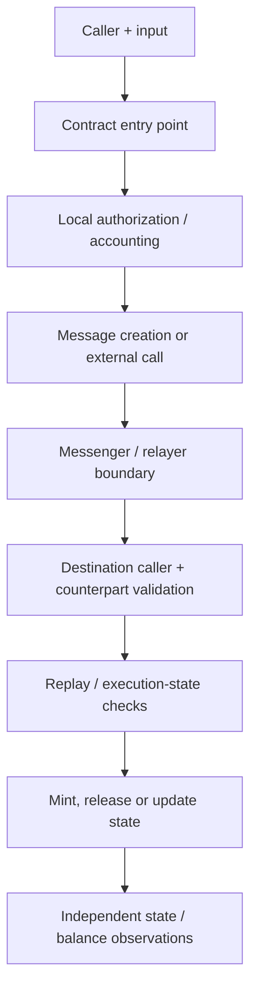
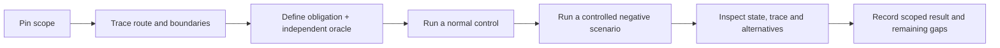

# Web3 review flow and trust boundaries

## Start from a concrete route

Pick one operation, source revision and configuration: deposit, withdrawal, conversion, migration or message finalization. Identify the entry point, caller, funds, message fields and final state change.

This diagram is a review checklist, not an execution specification for every linked bridge.

## Map a rule to a check

| Boundary | Example obligation | Evidence to inspect |
| --- | --- | --- |
| External caller → entry point | Only authorized roles perform privileged changes. | Actual caller, revert/result and unchanged or updated state. |
| Source operation → message | Encoded amount, recipient, token and destination correspond to the accepted operation. | Source state transition and decoded payload. |
| Messenger → destination | Caller and reported counterpart satisfy this deployment's authentication rules. | Caller, counterpart fields, configuration and destination checks. |
| Message → execution | A message cannot be executed again outside the documented retry semantics. | Message identifier, execution flags and repeated-call state. |
| Source → destination accounting | Settled value changes are reconciled with source actions, pending messages, fees and rounding. | Balances, supply, escrow and the relevant message ledger. |

Do not assume supply and backing must match at every asynchronous intermediate instant. First define the accounting model and the state at which an invariant is expected to hold.

## Build evidence

AI helps with source navigation, scenario generation and tests. A model's explanation is not the oracle; contract state, traces, balances and reproducible assertions are.

## Test extract example

[Katana](https://github.com/Keedz1Off/katana-vault-bridge-invariant-fuzzing) publishes five stateful flows with nineteen invariant functions and eleven stateless fuzz tests. Its historical README records 24 stateful-suite passes and 11 stateless passes. The extract uses local mocks and does not publish a production vulnerability proof.

For a source-review example, [Push Chain](https://github.com/Keedz1Off/push-chain-gateway-flow-local-review) records 27 checks, with four suspicious checks grouped into one unresolved event-data-integrity candidate.

Read next: [result classifications](FINDINGS.md).
