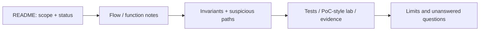

# How to read this portfolio

## Choose the evidence you want

- **Overall experience:** start with [README.md](README.md).
- **Architecture and security reasoning:** [FLOW.md](FLOW.md), then Arbitrum, Optimism or Push Chain.
- **Fixed security finding:** [Voxel Bench SR-01](https://github.com/Keedz1Off/voxel-bench-sr01-case-study), including its source revisions, authorship boundary and preserved evidence.
- **Executable-test work:** Katana's [case study](https://github.com/Keedz1Off/katana-vault-bridge-invariant-fuzzing/blob/main/PORTFOLIO_CASE_STUDY.md), then its [test directory](https://github.com/Keedz1Off/katana-vault-bridge-invariant-fuzzing/tree/main/test).
- **What was actually found:** [FINDINGS.md](FINDINGS.md). A candidate or deliberately broken lab is not a confirmed production finding.

## Reading order inside a case

| Common path | Meaning |
| --- | --- |
| `deposit-flow/`, `withdrawal-flow/`, `send-flow/`, `receive-flow/`, `flow/` | Follow the operation through its functions and contracts. |
| `concepts/`, `glossary.md`, `glossary/` | Definitions and protocol-specific concepts. |
| `break-think/` | Invariant reasoning or templates; check each file for its completion state. |
| `audit-notes/`, `poc-ideas/` | Suspicions and proposed checks; not automatic evidence of a vulnerability. |
| `exploit-labs/` | Simplified vulnerable/fixed examples for learning; do not attribute their invented defects to production. |
| `test/invariant/`, `test/fuzz/` | Published Solidity test extracts. Read setup, mocks and assertions before interpreting the result. |

Folder names vary; use the file map in the selected repository.

## Good questions for a technical review

1. Which revision and configuration are covered?
2. What security obligation is tested, and when must it hold?
3. Who controls the relevant input or caller?
4. What independent observation proves the result?
5. Does the test exercise upstream code, a mock, or a deliberately broken example?
6. What remains untested?

This hub organizes existing evidence. The navigation update on 31 October 2026 adds no new protocol execution or vulnerability-validation result.
