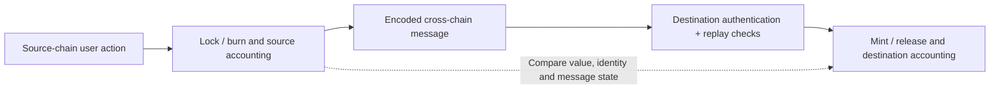

# Stefan | Web3 Security Portfolio

My Web3 work focuses on **smart-contract flows, cross-chain authorization, bridge accounting, and invariant-based testing**. This repository is the entry point to my existing public reviews and test extracts.

I use source tracing, architecture maps, local checks, Foundry tests and AI-assisted analysis. Each linked case retains its own scope and evidence limits.

## ETHGlobal participation

I participated in **ETHOnline 2026** with [Voxel Bench](https://github.com/ETH-GLOBAL-ONLINE/voxel-bench), an agent-driven 3D asset project using onchain payments and recipe royalties. My documented security contribution was the **SR-01 recipe-authorship finding**, with AI-assisted contract review, local reproduction and test evidence. The team implemented the attester-based fix.

[SR-01 case study](https://github.com/Keedz1Off/voxel-bench-sr01-case-study) · [Project acknowledgement](https://github.com/ETH-GLOBAL-ONLINE/voxel-bench/blob/2734fc4e31a6763986a62d5bdf2704e770c1c71d/docs/CONTRACT_AUDIT.md#findings)

## Start with the work

| Case | What it demonstrates | Type |
| --- | --- | --- |
| [Voxel Bench — SR-01](https://github.com/Keedz1Off/voxel-bench-sr01-case-study) | First-observer recipe authorship capture, royalty attribution and the implemented attester boundary. | Publicly acknowledged, fixed finding; historical local evidence. |
| [Katana Vault Bridge](https://github.com/Keedz1Off/katana-vault-bridge-invariant-fuzzing) | Stateful action sequences, backing/supply and reserve invariants, stateless deposit/withdraw fuzz checks. | Public local test extract; mocks. |
| [Push Chain Gateway](https://github.com/Keedz1Off/push-chain-gateway-flow-local-review) | Gateway → vault → message finalization; authorization and transaction-data integrity checks. | Contest-oriented source review; one unconfirmed candidate. |
| [Arbitrum Bridge](https://github.com/Keedz1Off/arbitrum-bridge-flow-local-review) | Deposit/withdrawal flow, address aliasing, message authenticity and accounting. | Educational architecture/source review. |
| [Optimism Bridge](https://github.com/Keedz1Off/optimism-bridge-flow-local-review) | Messenger authentication, counterpart checks, replay and lock/mint/burn/release relationships. | Educational review and simplified labs. |
| [LayerZero OFT](https://github.com/Keedz1Off/layerzero-oft-flow-local-review) | Debit/burn → encoded message → receive/credit; peer binding and amount conversion. | Source-flow review and simplified labs. |
| [Sky / OP Token Bridge](https://github.com/Keedz1Off/Keedz1Off-sky-dai-fork-local-review) | Escrow, mint/burn, token registration, administrative and withdrawal limits. | Supporting architecture study. |
| [Arbitrum L3](https://github.com/Keedz1Off/arbitrum-l3-bridge-flow-local-review) | Layered bridge assumptions and message paths. | Supporting architecture study. |

**Suggested first read:** Voxel Bench for a fixed security finding; Katana for invariant/fuzz work; Arbitrum or Optimism for architecture explanations.

## How I follow a bridge

This is a conceptual map. Individual bridges have different execution, finality, fee and rounding rules. In-flight messages must be tracked before comparing cross-chain accounting.

**Reading route:** [file navigation](READING-GUIDE.md) → [architecture and boundaries](FLOW.md) → a linked case → its tests or evidence → [result classifications](FINDINGS.md).

## What the portfolio shows

- Following funds, caller identities and payloads across contracts.
- Turning documented assumptions into explicit, testable invariants.
- Checking message authenticity, replay protection, recipient/token binding and accounting.
- Separating a suspicious code path, an educational broken example, a local test result and a confirmed vulnerability.

See [FINDINGS.md](FINDINGS.md) for the reviewed evidence status. A passing local suite is scoped evidence, not certification of a production deployment.

[GitHub profile](https://github.com/Keedz1Off) · [AI agent work](https://github.com/Keedz1Off?tab=repositories&q=case-study)
